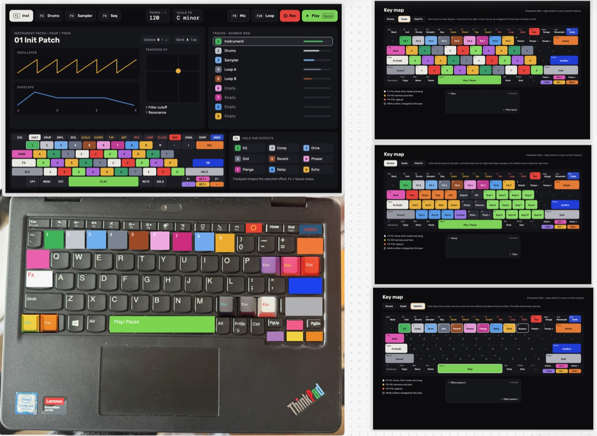
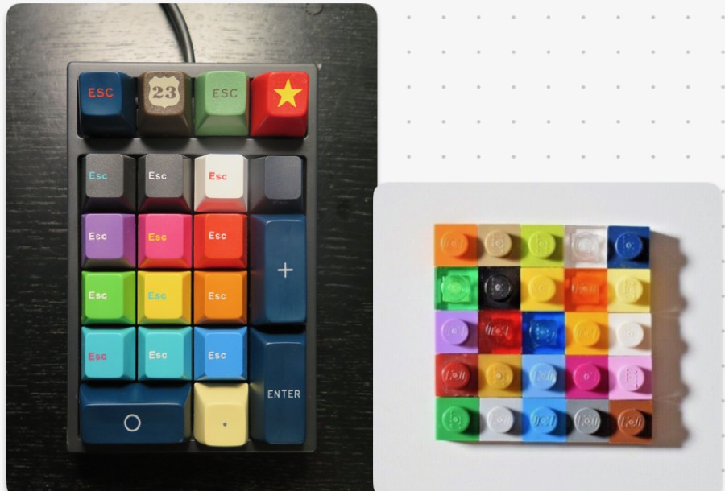

# oskey — Oskie's ThinkPad instrument

Oskie (@oskie) sent two mockups on 2026-10-24: a ThinkPad 11e turned into a
standalone sampler/instrument, keeping the hardware but recontextualising the
keyboard so it reads as an instrument. `pieces/oskey.mjs` is the first
playable cut of that mockup on AC OS.

## What the mockup asks for

- Three modes: **instrument / drums / sampler**; sequencing lives in the
  sampler side. F1–F4 pick modes and the sequencer view.
- Number row = nine **tracks** (Instrument, Drums, Sampler, Loop A, Loop B,
  four empty).
- **Scale layer**: every letter key is a scale degree, +1 per key to the
  right and +2 per row up, so a diagonal of three keys is always a triad.
- **Drums layer**: the letter block becomes 24 pads, left hand plays the kit,
  right hand plays samples.
- **Hold Fx** (Caps): the number row becomes the effect rack, Space stops.
- Tab = bank, Shift = accent, Space = play/pause, Enter = confirm,
  Backspace = delete, Insert = undo, -/+ = octave, trackpad XY shapes the
  selected effect.
- Keycaps swapped or painted by role so the colours on screen match the
  colours under the fingers (second image: a coloured numpad and a Lego grid).

## What v0 ships

| mockup | oskey v0 |
|---|---|
| F1 Inst / F2 Drums / F3 Sampler / F4 Seq | same |
| F5 Scale, F6 Chord, F7 Tap, F8 Quant | F5 scale, F6 chord, F7 tap tempo, F8 root |
| F9 Mic, F10 Loop, F11 Click, F12 Rec | F9 record/cut mic, F10 loop 1↔2 bars, F11 click, F12 record-arm |
| oscillator + ADSR patch panel | 14 patches: saw/square/tri/sine + GM voices; A/D per patch, drawn |
| trackpad XY = filter cutoff / resonance | XY = echo send / room send (the engine has sends, not a filter yet) |
| Fx rack 1–9 | Caps + 1 room, 2 echo, 3 glitch |
| 24 pads | 12 kit pads (left) + 12 zoo samples (right); col 4 free |
| sequencing | 16/32-step loop per track, live record, F4 grid edit |
| keycaps by role | the on-screen keyboard is painted by role as a paint guide |

Dev loop: boot the stick, then from this directory
`scripts/dev-push.sh <name>.local oskey --watch` hot-reloads edits, and
`claude` on the device (aesel) can edit `/pieces/oskey.mjs` in place.
