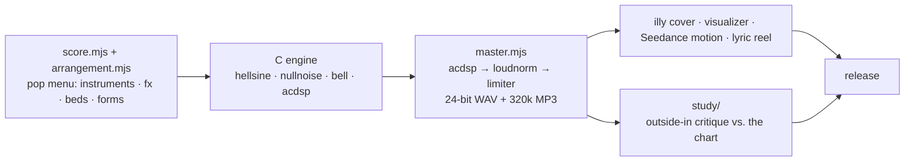
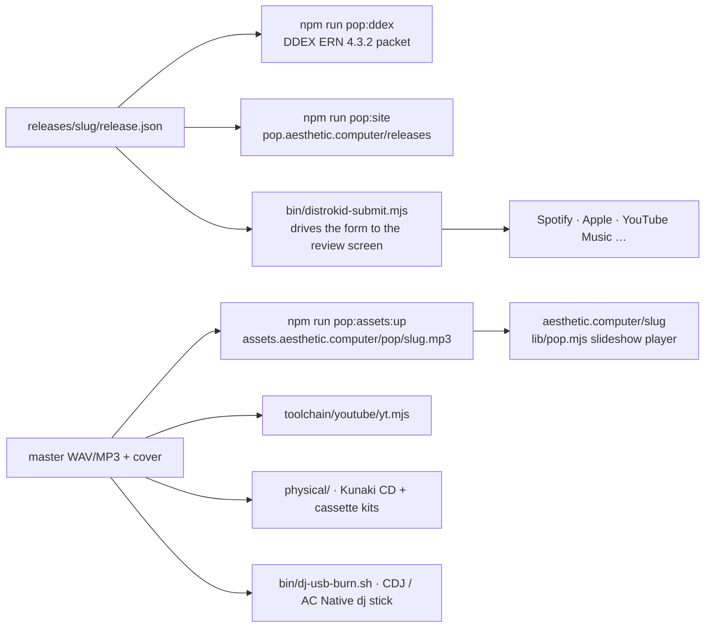

# AC Musicking

Everything Aesthetic Computer has around music, sound and getting records out
the door. Written 2026-10-28 for the NCC netlabel circle. One rule sits under
all of it: **music is built bottom-up from AC's own instruments, never from
end-to-end song generators.**

| | |
|---|---|
| Play | [aesthetic.computer](https://aesthetic.computer) → type `notepat`, `tracker`, `dj`, `juke` … |
| Listen | [pop.aesthetic.computer/releases](https://pop.aesthetic.computer/releases/) · [Aesthetic Dot Computer on Spotify](https://open.spotify.com/artist/7hqUS0ZErVZ3JzdeBEEgDr) · [Whistlegraph Dot Org on Spotify](https://open.spotify.com/artist/04nh3YCovvkIOnefkCi7Hx) |
| Watch | [Whistlegraph TV](https://tv.whistlegraph.org) (24/7) · [YouTube](https://www.youtube.com/@aesthetic.computer) |
| Hear | AC Readings podcast, RSS `https://feeds.buzzsprout.com/2628235.rss` |
| Read | [`pop/SCORE.md`](SCORE.md) · [`pop/RELEASES.md`](RELEASES.md) · [`pop/MASTERING.md`](MASTERING.md) · [`spinging/README.md`](../spinging/README.md) |

---

## 1 · Play — instruments that live at a URL

Every instrument is a *piece*: type its name at the prompt, or visit
`aesthetic.computer/<name>`. Nothing to install.

| piece | what it is |
|---|---|
| [`notepat`](https://aesthetic.computer/notepat) | pads + QWERTY keyboard, General MIDI instruments, MIDI in. Publishes notes to the session server so other machines (and an Ableton `notepat-remote` device) can hear them |
| [`tracker`](https://aesthetic.computer/tracker) · [`melody`](https://aesthetic.computer/melody) | compose with 12 tones; play tracker scores back |
| [`chord`](https://aesthetic.computer/chord) · [`beat`](https://aesthetic.computer/beat) · [`tone`](https://aesthetic.computer/tone) · [`bleep`](https://aesthetic.computer/bleep) | one chord · a percussion kit · one oscillator · boxes that make tones |
| [`metronome`](https://aesthetic.computer/metronome) | tap tempo; syncs to a DAW over Max for Live |
| [`whistle`](https://aesthetic.computer/whistle) | whistle into the mic, get the melody back as sine waves |
| [`stample`](https://aesthetic.computer/stample) | spread one sample across the pads |
| [`song`](https://aesthetic.computer/song) · [`sing`](https://aesthetic.computer/sing) | write melody + lyrics; a character sings it back |
| [`dj`](https://aesthetic.computer/dj) | one big record; drop a file and scratch it (desktop app, and AC Native from USB) |
| [`juke`](https://aesthetic.computer/juke) · [`play`](https://aesthetic.computer/play) | jukebox of every /pop track · generic player |
| [`baktok`](https://aesthetic.computer/baktok) | learn to talk backwards |

Pieces are JavaScript or **KidLisp**, a tiny Lisp for generative art and sound.
KidLisp sound built-ins: `pluck bell sub flute hat voice overtone noise mic
amplitude melody speaker` plus `amp` and `beat`. The JavaScript API gives a
piece `sound.synth` (sine, square, triangle, saw, noise, pluck, whistle,
sample), sample playback, microphone amplitude / waveform / pitch / recording,
speaker analysis for visuals, a BPM clock, MIDI in, reverb and glitch sends.

- Authoring guide: [`system/public/aesthetic.computer/disks/CLAUDE.md`](../system/public/aesthetic.computer/disks/CLAUDE.md)
- KidLisp: [`kidlisp/README.md`](../kidlisp/README.md)

**Menu Band** ([`slab/menuband/`](../slab/menuband/)) is the same keyboard as
a macOS menu-bar app: CoreAudio + CoreMIDI, GM instruments, metronome, tape
deck. [On the Mac App Store](https://apps.apple.com/us/app/menu-band/id6767311903)
since July 2026; full build at prompt.ac/menuband.

## 2 · Record

- **`tape`** at the prompt records the canvas plus audio (`tape:mic`,
  `tape:nomic`, `tape:neat`, `tape:tt`, `tape:add`) and opens an export /
  upload screen. Posted tapes get a `!code`, list in `tapes`, replay in `replay`.
- **Menu Band takes** export `<title>.mp3` + stems to the Desktop and feed the
  remix lane: `take-remix.py → take-platter.mjs → take-orchestrate.mjs` in
  [`pop/menuband/bin/`](menuband/bin/).
- **Real singing as reference.** The vocal-shape targets in the voice tools
  were measured from actual acapella takes.

## 3 · Compose and render — `pop/`

[`SCORE.md`](SCORE.md) calls this "the research home for music, not a label."
One directory per track (a *lane*).

1. **Compose.** `<lane>/score.mjs` + `arrangement.mjs` drive
   `<lane>/bin/render*.mjs` using the **pop menu** ([`lib/menu.mjs`](lib/menu.mjs):
   instruments, fx, percussion, beds, master, pitch/time, analysis, vocal,
   scales, forms, modulation, score, sample sources). New lanes start with
   `node pop/bin/render-composition-beds.mjs` and elect a bed with `--elect NN`.
2. **DSP in C.** ~30 lanes carry a `c/` engine. [`hellsine/c`](hellsine/c/) is
   all sines. [`nullabye/c/nullnoise.c`](nullabye/c/nullnoise.c) runs two
   pink-noise copies phase-cancelled to silence; every sound is an EQ bell
   breaking the cancellation. [`realtime/c/measure-engine.c`](realtime/c/)
   composes bar by bar live, sample clock in charge, nothing AI inside the
   audio callback. [`dsp/`](dsp/) is **acdsp**: portable C99 compressors + EQ
   for CLI, wasm and AC Native.
3. **Master.** [`lib/master.mjs`](lib/master.mjs) → acdsp → ffmpeg two-pass
   loudnorm + limiter → 24-bit WAV + 320k MP3 with a LUFS readout. Recipe in
   [`MASTERING.md`](MASTERING.md): shape loudness in the arrangement, static
   gain into an oversampled true-peak limiter, bass mono below 120 Hz, gate on
   a phone-speaker proxy and a mono fold.
4. **Study.** [`study/`](study/) critiques a finished single outside-in
   (loudness, structure by self-similarity, six-band energy, percussive share,
   key per section) and compares it against the week's chart.
5. **Cover + video.** `illy` (OpenAI / fal.ai backends, AC logo as reference),
   `preview-score-*-yt.mjs` visualizers, Seedance 2.0 motion shots
   ([`lib/motion-pipeline.mjs`](lib/motion-pipeline.mjs)), lyric reels
   ([`viz/lyric-reel.py`](viz/)), 9:16 cuts ([`bin/tiktok.mjs`](bin/tiktok.mjs)).

**Samples and licensing.** freesound (CC, attributions kept), CC0 sampled
instruments (Salamander piano), BBC Rewind only for non-commercial use and
never in a release master.

## 4 · Voice — spinging

[`spinging/`](../spinging/) is the speech-to-singing stack. Text → spoken take
in a cloned ElevenLabs voice → whisper + Wiktionary IPA alignment → a
choral-notation score → WORLD vocoder resynthesis: the note lives on the
vowel, consonants stay natural length as beat pickups, pitch locks with an
adjustable harmony-strength knob, a self-choir stacks under the lead, master
to −14 LUFS. QA is statistical (percentile bands from real sung vocals) plus a
whisper intelligibility gate on the rendered line.

[`live/singer.c`](../live/) does the same in realtime for the singing Macs on
stage. Autotune for any vocal slice is WORLD f0 replacement
([`bin/pitchsnap_world.py`](bin/pitchsnap_world.py)), never a pitch-shifted stretch.

## 5 · Release and distribute

Two artist names on DistroKid, both with `aesthetic.computer` in the
record-label field. Album name on the Aesthetic Dot Computer side: `pixsies`.

| artist | Spotify | first release |
|---|---|---|
| **Aesthetic Dot Computer** | [7hqUS0ZErVZ3JzdeBEEgDr](https://open.spotify.com/artist/7hqUS0ZErVZ3JzdeBEEgDr) | trancenwaltz · 2026-05-17 |
| **Whistlegraph Dot Org** | [04nh3YCovvkIOnefkCi7Hx](https://open.spotify.com/artist/04nh3YCovvkIOnefkCi7Hx) | lonerclub v4pid · 2026-08-27 |

### Released

| title | AC page | Spotify | YouTube | released |
|---|---|---|---|---|
| trancenwaltz | [▶](https://aesthetic.computer/trancenwaltz) | [♫](https://open.spotify.com/track/3PIPwPqptVlWy71rCEhQum) | [▶](https://youtu.be/RBG3k_XsfLA) | 2026-05-17 |
| trancepenta | [▶](https://aesthetic.computer/trancepenta) | [♫](https://open.spotify.com/track/4SVH80CTkq2BihSlSyiJhG) | [▶](https://youtu.be/Em_lvTYET7M) | 2026-05-20 |
| helpabeach | [▶](https://aesthetic.computer/helpabeach) | [♫](https://open.spotify.com/track/3jzlAylJQLSsNIXjnEY1e8) | [▶](https://youtu.be/KVynj0RAwg8) | 2026-05-21 |
| marimbaba | [▶](https://aesthetic.computer/marimbaba) | [♫](https://open.spotify.com/track/1gopbVPw6LoinIpOANOnEG) | [▶](https://youtu.be/EqX7Lkr5aRs) | 2026-05-22 |
| hellsine | [▶](https://aesthetic.computer/hellsine) | [♫](https://open.spotify.com/track/1yauGyuJPMzDadtu8S5llk) | [▶](https://youtu.be/IjMGmPDvO4I) | 2026-05-26 |
| amaythingra | [▶](https://aesthetic.computer/amaythingra) | [♫](https://open.spotify.com/track/4hVFWMISa235ybIEfOYuwt) | [▶](https://youtu.be/2FwOYCXS4UA) | 2026-05 |
| momabobasheep | | | [▶](https://youtu.be/GCOhg5J-brw) | 2026-06-12 |
| Fluttabap360 | [▶](https://aesthetic.computer/fluttabap360) | | | 2026-06-30 |
| americomputadora | | | | 2026-07-04 |
| Wattajetta Stone Club | [▶](https://aesthetic.computer/wattajetta-stone-club) | | | 2026-08-09 |
| Femrag++ | [▶](https://aesthetic.computer/femrag-plusplus) | [♫](https://open.spotify.com/track/2v7LcVM38kpiIYd0RWQJzm) | | 2026-08-27 |
| lonerclub v4pid | | [♫](https://open.spotify.com/album/6ocFjxuo0tGamINUijXeTw) | | 2026-08-27 · Whistlegraph Dot Org |
| amazing grace | [▶](https://aesthetic.computer/amazing-grace) | | | 2026-09-23 |
| wannadash | [▶](https://aesthetic.computer/wannadash) | | | 2026-10-05 |
| sailor song | [▶](https://aesthetic.computer/sailor-song) | | | 2026-10-06 · AC only |
| eight gigabytes | | | | submitted 2026-10-12 |

Full ledger with masters, LUFS, covers and DistroKid ids: [`RELEASES.md`](RELEASES.md).

### The release spine

| stage | what exists |
|---|---|
| release record | [`releases/<slug>/release.json`](releases/) — public metadata; rights data in a gitignored private overlay |
| DDEX | `npm run pop:ddex` ([`bin/ddex.mjs`](bin/ddex.mjs)) writes a DDEX ERN 4.3.2 packet. **Evaluation only**, placeholder IDs, not for delivery yet |
| release site | `npm run pop:site` ([`bin/publish-release-records.mjs`](bin/publish-release-records.mjs)) → [pop.aesthetic.computer/releases](https://pop.aesthetic.computer/releases/) |
| DistroKid | [`bin/distrokid-submit.mjs`](bin/distrokid-submit.mjs) drives the form in Chrome up to the review screen; a human clicks release. Lessons: upload **FLAC** (10 MB cap), songwriter rows need a legal name, set the release date explicitly, claim Spotify for Artists separately |
| self-hosting | `npm run pop:assets:up` syncs [`system/public/assets/pop/`](../system/public/assets/pop/) to the CDN: `assets.aesthetic.computer/pop/<slug>.mp3 · .jpg · .mp4`. Each track gets a page at `aesthetic.computer/<slug>`: a 25-line wrapper around [`lib/pop.mjs`](../system/public/aesthetic.computer/lib/pop.mjs), a slideshow player that streams the mp3 and shows one illustration per section. The iPhone app has a native /pop player |
| YouTube | [`toolchain/youtube/yt.mjs`](../toolchain/youtube/) — zero-dependency OAuth uploader for two channels (`--as whistlegraph`). House rules: Title-Case one-word titles, hashtag-only descriptions, landscape only |
| physical | [`physical/`](physical/) cuts Red Book 44.1/16 masters for the nine-track *pixsies so far* program, then builds a jewel-case CD kit and a two-sided cassette kit for [Kunaki](https://www.kunaki.com) (on demand, no minimums). `kunaki-order.mjs` quotes, places and tracks orders. Mockups via illy on Kunaki's [artwork templates](https://kunaki.com/artwork.htm) |
| DJ USB | [`bin/dj-usb-collect.sh`](bin/dj-usb-collect.sh) + [`bin/dj-usb-burn.sh`](bin/dj-usb-burn.sh) → MBR/FAT32 stick for Pioneer CDJs and the AC Native `dj` piece |
| WIP sharing | scores travel by git; finished mp3s converge across machines with [`bin/juke-sync.sh`](bin/juke-sync.sh) (S3 prefix, newest wins, every 20 min) |

## 6 · Broadcast

- **Whistlegraph TV** — [`toolchain/tv/`](../toolchain/tv/) turns any web page
  into a 24/7 RTMP stream (Xvfb + PulseAudio null sink + Chrome kiosk +
  ffmpeg) with [`toolchain/youtube/live.mjs`](../toolchain/youtube/) managing
  the broadcast. Live since 2026-09-01, airing [tv.whistlegraph.org](https://tv.whistlegraph.org).
- **Laer Klokken / [laklok.com](https://laklok.com)** — a Danish
  computer-music community chat run on AC
  ([`disks/laklok.mjs`](../system/public/aesthetic.computer/disks/laklok.mjs)
  plus a vector sister at laklok.com/html). Its crew will play netlabel
  releases on their r8dio.dk show, which also airs on some European FM
  stations. [`marketing/klokkentales/`](../marketing/klokkentales/) turns the
  chat into short storybook podcast episodes.
- **AC Readings** — [`marketing/podcast/`](../marketing/podcast/) turns essays
  into spoken-word episodes (jingle, lo-fi bed, cover) published through
  Buzzsprout, which fans out to Spotify, Apple and YouTube. A daily
  two-minute *Aesthetic Computer Radio* is written from the day's commits.
- **Instagram / TikTok** — [`slab/bin/instagram-mcp.mjs`](../slab/bin/instagram-mcp.mjs)
  posts reels through the Graph API; the whistlegraph trial-reel lane runs
  daily; [`bin/tiktok.mjs`](bin/tiktok.mjs) renders beat-timed 9:16 word videos.

## 7 · Perform

- **AC Native OS** ([`fedac/native/`](../fedac/native/)) boots laptops
  straight into AC. [`src/audio.c`](../fedac/native/src/audio.c) is a
  many-voice engine (sine, square, saw, noise, whistle, harp, pluck, piano,
  e-piano, synth bass, modal, GM piano from a SoundFont) with native `notepat`
  and `dj`. [`pieces/song-cue.mjs`](../fedac/native/pieces/song-cue.mjs)
  preloads songs over the LAN and plays them only on a matching cue, for
  synced shows across machines.
- **venue** ([`toolchain/mcp/ac-venue-mcp.mjs`](../toolchain/mcp/)) treats the
  CultureHub LA room as one instrument: six AC OS laptops, a Windows sub, DMX
  lighting and three singing Macs, with a setlist and prepare / check / cue / result.
- **MacNeoPolitan Trio** — three MacBook Neos conducted from one `.mbscore`
  via [`slab/menuband/bin/conduct.mjs`](../slab/menuband/bin/), with a
  self-choir that harmonizes with the band's chord.
- **notespatial** — an 11-chapter suite for five laptops in a ring plus one at
  the center, printed binaurally ([`notespatial/`](notespatial/); paper in
  [`papers/iclc-2027-notespatial`](../papers/iclc-2027-notespatial/)).
- **eight gigabytes live** — [`eightgigabytes/live/performer.swift`](eightgigabytes/live/)
  reuses Menu Band's singer, face and caption code for the stage.

## 8 · What this offers a netlabel

- **A release spine to copy.** `release.json` → DDEX packet → static release
  page → DistroKid → CDN mp3 + per-track page. Fork it for a club subdomain;
  the slideshow player and tape `!codes` are ready-made listening pages.
- **Physical kits.** The Kunaki CD / cassette pipeline and the mockup route
  already exist for a winter release. It needs masters and a cover.
- **Mastering + critique.** One recipe, one study tool, so a compilation
  lands at one loudness and nobody argues by ear alone.
- **Radio and TV.** A Laer Klokken slot on r8dio.dk, and the 24/7 rig pattern
  for a club station on YouTube.
- **Instruments anyone can play by URL**, including on bare-metal AC Native
  laptops, for shows and for making the records themselves.
- **A podcast rig** for a label show, with Buzzsprout fan-out.
